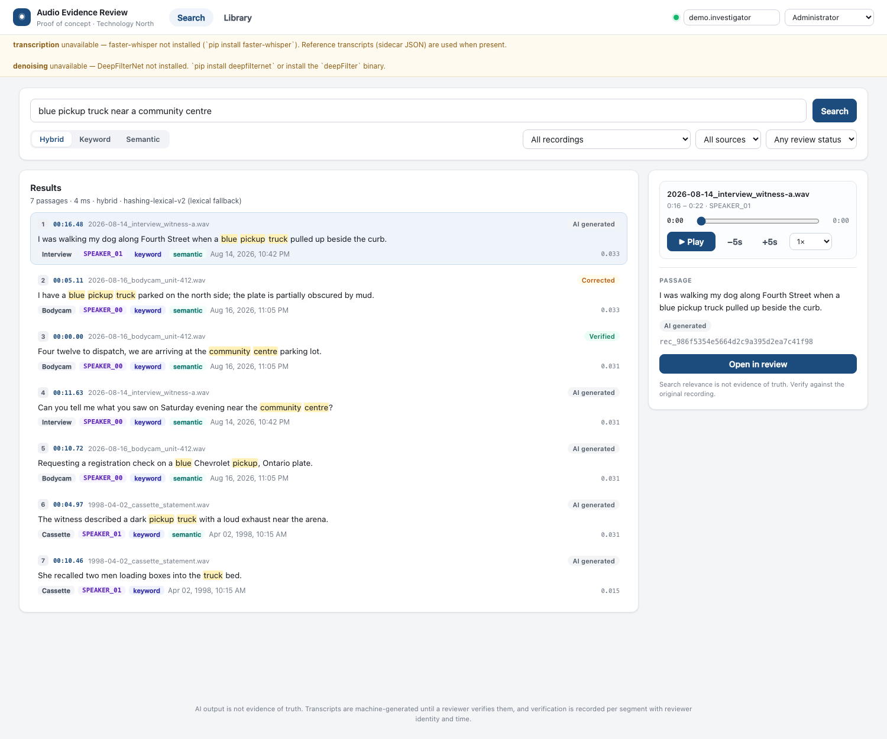
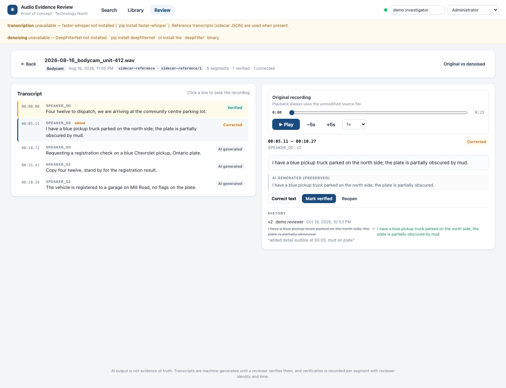
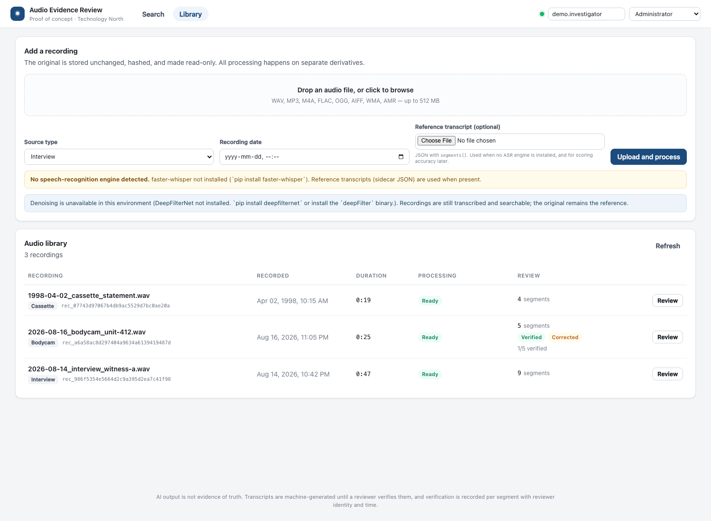

# AI Audio Evidence Search & Review — PoC

Turns audio evidence (interviews, body-camera audio, cassette transfers) into a
searchable, timestamped, reviewable transcript corpus.

An investigator types *"blue pickup truck near a community centre"*, gets ranked
passages with timestamps, and the original recording jumps to the right second.
A reviewer then corrects the transcript and verifies it — with the AI text, every
revision, and every action preserved.

Built to the PRD in [`PRD.md`](./PRD.md). Runs end-to-end today; ASR, denoising,
and semantic embeddings are swappable and degrade with an explicit reason instead
of breaking the pipeline.

| | |
|---|---|
| **Backend** | Python 3.12 · FastAPI · SQLAlchemy 2 · PostgreSQL (SQLite fallback) |
| **Frontend** | React 18 · TypeScript · Vite |
| **Retrieval** | Postgres FTS / SQLite FTS5 + Qdrant or local cosine, fused with RRF |
| **Audio** | FFmpeg · DeepFilterNet (optional) · WhisperX / faster-whisper (optional) |
| **Tests** | 113 passing, covering every acceptance criterion |

---

## Screens

**Search** — natural-language query, three retrieval modes, filters, and a player
that jumps to the matched timestamp.



**Review** — transcript beside the player, correction with the AI text preserved,
explicit verification, and revision history.



**Library** — upload, live processing state, review counters, retry on failure.



---

## Quick start

### Option A — Docker Compose (PostgreSQL + Qdrant + worker)

```bash
docker compose up --build
# UI  → http://localhost:8080
# API → http://localhost:8000/docs
```

The default image has **no ASR models** (they are ~2 GB+). Upload a reference
transcript alongside each recording, or build with models:

```bash
docker compose build --build-arg INSTALL_ASR=true api worker
docker compose up
```

### Option B — Local, no infrastructure

Uses SQLite and an in-process cosine index. FFmpeg must be on `PATH`.

```bash
cd backend
python3 -m venv .venv && ./.venv/bin/pip install -r requirements-dev.txt
./.venv/bin/python scripts/make_demo_data.py --upload http://127.0.0.1:8000 &
DATA_DIR=../data ./.venv/bin/uvicorn app.main:app --reload --port 8000
```

```bash
cd frontend && npm install && npm run dev   # http://localhost:5173 (proxies /api)
```

Or build the UI once and let FastAPI serve it: `npm run build`, then open
<http://localhost:8000>.

### Option C — Makefile

```bash
make setup     # venv + backend and frontend dependencies
make api       # terminal 1: API on :8000 (inline processing, SQLite)
make demo      # terminal 2: generate demo audio and ingest it
```

---

## Showing it to someone else

`make share` puts the running demo on a public HTTPS URL in about ten seconds:

```bash
make api        # terminal 1
make build-ui   # once, so FastAPI serves the SPA
make share      # terminal 2 → prints a https://<random>.trycloudflare.com link
```

It verifies the link before printing it (health, search, corpus count), so the
URL in the banner is one that actually works. Ctrl-C closes it.

**Why a tunnel and not a cloud deploy.** The demo is only convincing with the
real pipeline behind it, and no free PaaS offers that:

| | Tunnel (this) | Render free | HF Docker Space |
|---|---|---|---|
| ffmpeg + ASR + denoiser | yes, already installed | 0.1 CPU, 512 MB — no | requires **paid PRO** |
| evidence corpus survives a restart | yes (local disk) | no — ephemeral FS | no — ephemeral |
| cold start | none | ~1 min after 15 min idle | sleep on idle |
| cost | free, no account | free (750 h/mo) | paid |

The measured footprint is 152 MB resident with every component loaded, so RAM
was never the blocker — **ephemeral storage** is. The 119 MB corpus is rightly
gitignored, so a cloud deploy boots with an empty database and nothing to
search.

**This is a demo link, not a deployment.** `ALLOW_ANONYMOUS=true` with
`DEV_DEFAULT_ROLE=admin` means anyone holding the URL can upload, edit, verify
and export. The hostname is unguessable but that is not access control. Stop the
tunnel when the call ends, and never point this at real case material.

Two operational notes:

- The link dies when the laptop sleeps or the process stops. Keep it awake for
  the duration.
- On macOS the hostname can be negatively cached locally even while Cloudflare
  serves it, so a hand-run `curl` may say "could not resolve host" when the link
  is fine. The script verifies over DNS-over-HTTPS to avoid that trap.

---

## Real transcription (optional, recommended)

Without an ASR engine the pipeline falls back to reference transcripts. To get
actual machine transcription:

```bash
cd backend && ./.venv/bin/pip install faster-whisper
# or the full optional stack: pip install -r requirements-asr.txt
```

`GET /api/health` flips from `transcription: unavailable` to `available`, and
`TRANSCRIBER=auto` starts preferring the engine over the sidecar transcript. The
model downloads to `~/.cache/huggingface` on first use — **282 MB for `base`,
927 MB for `small`** (measured, float16 CTranslate2 weights).

**Measured on this machine** (Apple Silicon, CPU, int8) with
`scripts/evaluate_asr.py`, which scores ASR against the reference transcripts:

| Model | Noisy test set | Clean demo set | RTF | Verdict |
|---|---|---|---|---|
| `base` | 4.7% WER | 7.6% WER | 0.06 | fastest |
| `small` | **3.9% WER** | **7.1% WER** | 0.15 | default — 6× faster than realtime |

```bash
./.venv/bin/python scripts/evaluate_asr.py --dir ../data/test-audio --model small --show-errors 2
```

**Read the WER with care.** The clean set scores *worse* than the noisy one, which
looks wrong until you diff the errors — they are almost entirely non-acoustic:

| Reference | ASR | Cause |
|---|---|---|
| `Carla Nadeau` | `karla nato` | proper noun |
| `Morrow` | `moro` | proper noun |
| `twenty twenty six` | `2026` | number formatting |
| `four twelve` | `for 12` | number formatting |
| `centre` | `center` | Canadian vs US spelling |

The audio was transcribed correctly; the orthography differs, and word-level WER
counts that as an error. Proper nouns are the failure mode that actually matters
for evidence work — names are what investigators search for — and they are worth
weighting separately in any acceptance test.

**Known install trap:** PyAV 19 removed `av.open(metadata_errors=...)`, which
faster-whisper 1.2.1 still passes, so every transcription fails with
`TypeError: open() got an unexpected keyword argument 'metadata_errors'`.
`requirements-asr.txt` pins `av<19` for this reason.

**Language is pinned to English by default** (`WHISPER_LANGUAGE`). Autodetection
failed silently and badly on real room-microphone audio — Whisper chose *Welsh*
at p=0.73 and emitted gibberish, scoring 77.0% WER where forcing English gave
40.4%. Set `WHISPER_LANGUAGE=auto` to opt back in. A transcript in the wrong
language is worse than no transcript, because it looks like a result.

---

## Real recordings — real voices, real room, human transcript

The demo and noisy sets are synthetic, so they prove the plumbing works but say
nothing about accuracy on real speech. [`data/real-audio/`](data/real-audio/README.md)
holds three clips from the **AMI Meeting Corpus** (CC BY 4.0): real people, a real
table microphone, and a human transcript with speaker labels and timings.

```bash
cd backend && ./.venv/bin/python scripts/fetch_real_audio.py --headset
```

The headline is uncomfortable and worth reading in full rather than skimming:
**55.4% WER** on these clips versus 3.9% on the synthetic set. Decomposing it with
AMI's matched headset-microphone condition — *identical transcripts, identical
timings, only the capture differs* — shows where it comes from:

| Condition | WER | Content-term recall |
|---|---|---|
| Headset mic, one utterance per file | 22.9% | 86.2% |
| Distant mic, one utterance per file | 46.3% | 66.7% |
| Distant mic, whole clips | **55.4%** | 61.5% |

- **The microphone costs 23 points; speaker overlap costs 9 more.** Going from
  `small` to `medium` — 3× the compute — recovers only 3 points. For evidence
  work that argues for capture guidance at intake, not a bigger model.
- **Content-term recall is well above WER** (86% vs 23% on clean isolated
  speech). Sequence-aligned WER charges for word order; keyword search does not.
- **Denoising makes real room-mic audio worse** (+4.1% to +16.3% WER per file),
  after fixing a bug where its level drop, not its filtering, was being measured.
- **Three clips is not a benchmark.** It is enough to find the dominant error
  terms and to catch regressions.

The evaluation also produced two findings that changed the product code, not just
the write-up: language pinning (above) and RMS-matching the denoised derivative to
its source. Both are covered by tests.

---

## The real example that matters: an actual press conference

AMI is cooperative meeting speech between strangers. The recording that actually
tests this product is a **30-minute EPS / Technology North press conference**
about the autism employment programme and body-worn video redaction —
[`data/real-audio/eps-presser/`](data/real-audio/eps-presser/README.md). Real
subject matter, real proper nouns the language model has never seen, speakers who
are nervous on camera.

It inverts the usual WER story. Scored against the video's caption track:

| Variant | Words | WER | Term recall |
|---|---|---|---|
| original | 4,304 | 20.0% | 86.6% |
| denoised | 4,481 | 18.1% | 86.4% |

**Those numbers measure the reference, not the app.** The reference is YouTube's
*automatic* captions — another ASR system — and it is the weaker of the two. The
captions render "Edmonton" as `evington`, "Ling Huang" as `lang hang`, "Technology
North" as `nors uh`, "autism" as `ai`, and "body-worn" as `bodyw warn`. The
transcript the app produced gets all five right, and is penalised for it.

Counting correct mentions of entities verifiable from the video title, the
channel, and the people who introduce themselves:

| Entity | Captions | This app |
|---|---|---|
| Edmonton Police Service | 1 | **5** |
| Ling Huang | 0 | **2** |
| body-worn video | 0 | **11** |
| autism | 6 | **9** |
| Technology North | 15 | **17** |
| redaction | 14 | **18** |
| **total correct** | 88 | **110** |
| **total mangled** | 20 | **6** |

**Denoising: no verdict from this recording.** Whole-file WER moves 1.9% in its
favour; split into ten 3-minute windows that becomes 3 wins, 2 losses, 5 ties,
with swings from 11.6% to 38.6%. Both variants make the same substitutions in the
same places — the difference is how much silence and crosstalk each pass chose to
transcribe. That is segmentation variance, not filtering benefit. It stays a
listening aid.

**Retrieval is the part that works**, and it is the point:

| Query | Top hit | Time |
|---|---|---|
| `Edmonton Police Service` | "which the Edmonton police service controls" | 938.2 s |
| `body worn video redaction` | "in order to do body-worn video redaction?" | 26.7 s |
| `Ling Huang` | "My name is Ling Ling Huang." | 225.3 s |

Timestamps verified independently: transcoding 204–211 s and re-running ASR on
that clip alone yields *"I'd like to introduce Ling Huang, who's the President and
CEO of Technology North"*. The audio really says that there. Range requests on the
30-minute original return `206` with `content-range: bytes 0-2047/34983688`.

---

## Two ways in: triage or full index

**The economics that drove this.** A large agency runs a hundred-plus hours of
911 audio a day, much of it on microcassette recorded over decades. When one case
reopens after ten years, an investigator needs twenty minutes out of thousands of
hours — and, as the brief put it, *"the police is not going to spend a million
dollars to digitize and do a full index."* A tool that only knows how to index
everything is a tool that never gets used on the archive.

So intake has two modes, chosen per upload in the Library:

| Mode | What happens | Cost | Use it for |
|---|---|---|---|
| **Full** | hash → working copy → denoise → ASR → segments → embeddings | minutes per hour of audio | current-case material you will search now |
| **Triage** | hash → probe (duration, sample rate, channels, codec) → status `triaged` | seconds | everything else — the archive |

A **triaged** recording is a first-class evidence item, not a stub:

- it is hashed and the digest is recorded, so it is citable;
- it reports its duration, so the twenty minutes can be located by ear;
- it streams through the same Range-aware endpoint, so it plays and seeks;
- it contributes **nothing** to search — deliberately, and the UI says so rather
  than returning an empty result set that looks like a bug.

Promotion is explicit: **"Index now"** on the row reuses the retry path, and the
recording becomes `ready` with segments and embeddings. Nothing is hidden about
the gap — the custody chain shows the triage entry and the later completion as
two separate stages (`intake_mode` reads `triage_promoted`), so a reviewer can
see the recording sat unindexed between those two dates.

Probed once at intake, so the metadata needed to find the tape later exists even
if the file is never transcribed:

```json
{ "mode": "triage", "probe": "ok", "transcribed": false,
  "note": "Registered and playable; not transcribed until a case needs it." }
```

---

## Denoising (DeepFilterNet)

Install the standalone Rust binary rather than the Python package:

```bash
curl -sSL -o /tmp/deepFilter \
  https://github.com/Rikorose/DeepFilterNet/releases/download/v0.5.6/deep-filter-0.5.6-aarch64-apple-darwin
sudo install -m 755 /tmp/deepFilter /usr/local/bin/deepFilter
deepFilter --version   # deep_filter 0.5.6
```

**Why not `pip install deepfilternet`?** It pins `numpy<2` and would downgrade
the environment from numpy 2.5 to 1.26 — a silent, environment-wide change to
enable one optional stage. The CLI is 27 MB, has no Python dependencies, and the
pipeline already supports it.

Two CLI behaviours the wrapper in `pipeline/denoise.py` handles for you:

- **WAV only.** It decodes with the Hound crate, so a FLAC working copy fails
  with `no RIFF tag found`. The wrapper transcodes to WAV, runs the filter, and
  stores the result back as FLAC.
- **Delay.** Without `-D` the output lags the input (~6 ms measured), which
  would misalign the original and denoised transcripts on the comparison screen.
  The wrapper always passes `-D`; measured lag afterwards is 0 samples.

And one it has to correct itself:

- **Level.** DeepFilterNet does not preserve level. Measured on AMI room-mic
  audio the output sat at **27% of input RMS**, with the active-speech fraction
  dropping from 47% to 16%. Whisper reacts badly to that: the same clip scored
  **95.2%** WER denoised versus **72.8%** once the level was restored, with the
  filtering unchanged. The wrapper RMS-matches the derivative to the source
  (`ffmpeg volumedetect` + `volume`), recording the applied gain as
  `level_matched_db`. Before this fix, every denoised comparison in the app was
  measuring a level drop rather than the denoising.

### Denoising does not improve transcription here — measured, not assumed

The PRD warns that "denoising must not be assumed to improve every recording".
On this corpus it doesn't. On the synthetic noisy set, with level matching in
place, it is an exact tie on all six files:

| File | WER original | WER denoised | Δ |
|---|---|---|---|
| 911 call | 5.0% | 5.0% | — |
| bodycam | 4.9% | 4.9% | — |
| interview | 3.9% | 3.9% | — |
| canvass | 3.3% | 3.3% | — |
| warehouse | 2.5% | 2.5% | — |
| voicemail | 2.3% | 2.3% | — |

On the **real** room-microphone clips it is materially worse:

| File | WER | WER denoised | Δ |
|---|---|---|---|
| `AMI_EN2002a_sdm.wav` | 63.5% | 78.2% | **+14.7%** |
| `AMI_EN2002b_sdm.wav` | 56.5% | 72.8% | **+16.3%** |
| `AMI_EN2002c_sdm.wav` | 39.6% | 43.7% | **+4.1%** |

Reproduce with `scripts/evaluate_asr.py --denoise`. The mechanism is visible in
the diff: suppression punches holes at word endings, at breathy consonants, and
in low-energy speech, and Whisper fills them with plausible words. On the
voicemail it *fixed* the one genuine acoustic error (`crack` → `cracked`) while
creating `case` → `tapes`. Lowering the attenuation limit (`-a 40/20/10`) did not
recover the difference reliably.

**So treat denoising as a listening aid, not a transcription aid.** It is worth
keeping in the pipeline — a reviewer can hear a cleaned copy — but the
original transcript remains the reference, and the comparison screen exists to
show exactly this.

The 30-minute press conference adds a third data point and it is a **tie, not a
win**: whole-file WER moves 1.9% in denoising's favour, but ten 3-minute windows
give 3 wins, 2 losses and 5 ties with swings from 11.6% to 38.6%. Both variants
make the same substitutions in the same places — the difference is how much
silence and crosstalk each pass chose to transcribe. So the three recordings now
read: synthetic = exact tie, AMI room-mic = worse, conference audio = noise.
**Nothing here supports claiming denoising improves transcription.**

### Denoise on demand, and listen to both

Denoising used to be an invisible stage of ingest: either the whole recording got
filtered or it didn't, and you found out afterwards. That is the wrong shape for a
listening aid — the reviewer is the one who decides whether a passage is
intelligible, and they decide it while listening to that passage.

So the Review screen carries a primary **"✦ Denoise this recording"** button:

- It runs against the stored original, writes a separate derivative, and never
  touches the source. If a working copy doesn't exist yet it builds one first.
- It reports back what actually happened — engine, version, whether delay
  compensation was applied, and the level match in dB — into `meta["denoise"]` and
  the custody chain. No success message that isn't backed by a file.
- With no denoiser installed it returns **503 with the reason** and the install
  command, rather than producing a silent no-op. It is a `retry`-level permission,
  so an investigator cannot spend CPU by accident.
- It refuses (`409`) while a processing job is queued or running.

The player then holds **both** versions and switches between them:

```
[ Original | Denoised ]   Switching holds the same position, so you hear
                          the same second both ways.
```

The switch preserves `currentTime` and play state, so it is a true A/B — the same
second of the same recording, filtered and unfiltered, without hunting for the
spot again. That is what makes the honest verdict above usable in practice: on
room-mic audio denoising *hurts* transcription, and a reviewer can hear for
themselves whether it helps them hear.


---

## The five-minute demo

```bash
cd backend && ./.venv/bin/python scripts/make_demo_data.py
```

This synthesises three **non-sensitive** recordings with real speech, exact
timestamps, and a reference transcript for each:

| Recording | Source | Why it exists |
|---|---|---|
| `2026-08-14_interview_witness-a.wav` | interview | clean two-speaker statement |
| `2026-08-16_bodycam_unit-412.wav` | bodycam | short operational exchanges, one over radio |
| `1998-04-02_cassette_statement.wav` | cassette | pink-noise hiss, so denoising has a purpose |

### Voice generation

Speech comes from a provider chain, `--engine {auto,edge,say,tone}`:

| Engine | What it is | When it is used |
|---|---|---|
| `edge` | `edge-tts` neural voices (`en-CA-ClaraNeural`, `en-CA-LiamNeural`, `en-US-AndrewNeural`) | default; needs `pip install edge-tts` and network |
| `say` | macOS `say`, preferring a Premium/Enhanced voice if installed | offline fallback |
| `tone` | tone bursts of the correct duration | last resort; pipeline still works |

`auto` walks that list and falls through on any error, printing which provider it
used and why the previous one was skipped. Speakers are cast to different voices
so the recordings sound like different people, dispatch is band-passed to
300–3400 Hz because radio traffic really is narrow-band, and per-line rate/pitch
varies deterministically to avoid the flat delivery that makes TTS sound synthetic.

**Falling back is a retry, not a knee-jerk reaction.** `edge-tts` throttles on
request bursts and reports `NoAudioReceived`, which looks like a hard failure but
is transient — the same line succeeds seconds later. Stepping down the chain in
response is *audible*: it drops a compact `say` voice into the middle of a neural
recording. So `edge` is retried up to 4 times with 0.4 s pacing and 2 s
exponential backoff before the chain is allowed to move on, and an exhausted retry
prints a `mixed voices` warning. `say` and `tone` are never retried: they fail
deterministically, so retrying only costs wall-clock (and `--engine say` must stay
instant). Missing dependencies (`ImportError`, `FileNotFoundError`) also fail fast
rather than sleeping ~14 s first.

Whether a build actually mixed voices is recorded, not just printed — per line in
each segment's `tts_provider`, and in aggregate in the sidecar's `tts` block:

```json
"tts": { "providers": { "edge": 9 }, "mixed": false }
```

The sidecar reader carries that into `Transcript.settings`, so the condition is
visible through `GET /api/recordings/{id}/transcript` rather than only on disk.

Synthesis is cached under `data/samples/.tts-cache/` keyed by
provider+text+voice+prosody, so a warm rebuild is byte-identical and instant; a
cold rebuild re-renders through the neural service and differs by ~0.1% (it is not
bit-reproducible). Timestamps are identical either way.

**Every line is synthesised separately and its real duration measured**, which is
what makes the timestamps exact rather than estimated. That is the property the
"jump to timestamp" demo rests on — don't "optimise" it into one big synthesis pass.

Then, in the UI:

1. **Search** `blue pickup truck near a community centre` → hybrid results, top
   two are the actual truck passages.
2. Click a result → the player seeks to that timestamp in the **original** file.
3. **Open in review** → correct a line, save. Notice the status becomes
   *Corrected*, not *Verified*.
4. **Mark verified** → reviewer identity and timestamp are recorded.
5. Open **History** → previous text, who changed it, when, and why.

### Noisy test set — for trying the pipeline on hard audio

The three demo files are deliberately clean. Real evidence is not:

```bash
cd backend && ./.venv/bin/python scripts/make_noisy_test_set.py
# then open the Library and drag the files in from data/test-audio/
```

Six more recordings with realistic degradation and the same exact-timestamp
sidecars, so timestamp playback is still testable at 4 dB:

| File | Noise | SNR |
|---|---|---|
| `2026-09-02_911_call_shop-lot.wav` | phone band, line hum, TV murmur | 12 dB |
| `2026-09-05_bodycam_traffic-stop.wav` | passing traffic, wind, mic saturation | 8 dB |
| `2026-09-11_interview_room_hvac.wav` | HVAC hum, room reverb | 20 dB |
| `2026-09-14_canvass_door-knock.wav` | wind, distant traffic | 6 dB |
| `2026-09-18_warehouse_loading-dock.wav` | machinery hum, metal clanks, reverb | 4 dB |
| `2026-09-21_voicemail_tip.wav` | tape hiss, line noise | 14 dB |

Noise is generated in numpy from physical models (traffic rumble, wind buffet,
mains hum, tape hiss, muffled speech through a wall) and scaled to a target SNR
against the measured speech RMS — so these double as a fixed-difficulty
benchmark once real ASR is installed. Rebuilds are byte-identical. See
`data/test-audio/README.md`, generated alongside the audio.

---

## Architecture

```
                       ┌──────────────────────────────┐
   upload ────────────►│  FastAPI                     │
   (audio + optional   │  ├─ library / playback       │
    reference JSON)    │  ├─ search (kw · sem · hyb)  │
                       │  └─ review / audit           │
                       └───────┬──────────────┬───────┘
                               │              │
                    ┌──────────▼───┐   ┌──────▼────────┐
                    │ PostgreSQL   │   │ Qdrant        │
                    │ recordings   │   │ segment       │
                    │ transcripts  │   │ vectors       │
                    │ segments     │   └──────▲────────┘
                    │ revisions    │          │
                    │ audit_events │          │
                    └──────▲───────┘          │
                           │                  │
                    ┌──────┴──────────────────┴──────┐
                    │  worker (python -m app.worker) │
                    │  probe → convert → denoise →   │
                    │  transcribe ×2 → embed → index │
                    └──────────────┬─────────────────┘
                                   │
                    originals/ (read-only, hashed)
                    working/   (16 kHz mono FLAC)
                    denoised/  (derivative)
```

Every stage is an interface with a real implementation, an optional one, and a
`Null` that reports why it is unavailable:

| Stage | Module | Implementations |
|---|---|---|
| Conversion | `pipeline/audio.py` | FFmpeg → 16 kHz mono FLAC |
| Denoising | `pipeline/denoise.py` | DeepFilterNet (python API or CLI), `Null` |
| Transcription | `pipeline/transcribe.py` | WhisperX · faster-whisper · sidecar reference · `Unavailable` |
| Embeddings | `pipeline/embed.py` | sentence-transformers · deterministic hashing |
| Vector store | `pipeline/vectorstore.py` | Qdrant · local cosine |
| Keyword index | `indexing.py` | Postgres GIN expression index · SQLite FTS5 |

---

## Evidence-handling guarantees

These are enforced in code, not just documented:

- **The original is never modified.** It is written once, hashed with SHA-256,
  `chmod 0444`, and served byte-for-byte with HTTP Range support. All processing
  reads it and writes elsewhere.
- **AI text is immutable.** `segments.ai_text` is written at ingest and never
  updated. Corrections go to `segments.text`.
- **Every change is a revision.** Text edits append to `revisions` with the
  previous text, new text, actor, timestamp, and reason.
- **Every action is an audit event.** Upload, processing, playback, edit,
  verify, verification withdrawn, export — all in `audit_events`, exportable as
  CSV.
- **Verification is explicit and revocable.** Editing a verified segment
  *invalidates* the verification and records `segment.verification_invalidated`
  rather than silently overwriting it.
- **Re-processing is blocked after human review.** Retry returns `409` if any
  segment has been edited or verified, because wiping transcripts would destroy
  review history.
- **Speakers are never named.** Labels are `SPEAKER_00`-style; the app never
  assigns a real identity from voice.

### Chain of custody, per recording

An audit trail that records everything is not the same as a chain of custody a
person can read. `audit_events` holds every action, including every playback — 57
of them on one demo recording — and rendering that verbatim buries the three
events that matter under a wall of noise.

`GET /api/recordings/{id}/provenance` is a **filtered projection** of the same
events, shaped as a chain:

- an allow-list of evidentiary stages — receipt, triage, denoise, processing,
  completion, export, verification, correction — and nothing else;
- oldest first, so it reads as a history rather than a log;
- each stage carries the actor and role, so *who did this* is answered, not just
  *what happened*;
- consecutive repeats of the same stage collapse into one entry with a count.
  Eleven verifications are one line: "Segment verified ×11", not eleven.

On the Review screen it appears as **"Chain of custody"**:

```
Received and hashed            demo.investigator   2026-10-19 16:42
Transcription and indexing completed   system      2026-10-19 16:43
Segment verified ×11           demo.investigator   2026-10-19 17:08
```

The full unfiltered trail remains at `/api/audit` and as CSV — the projection is
for reading, the raw log is for disclosure. Nothing is discarded, only shaped.

---

## Search design

| Mode | What it does |
|---|---|
| `keyword` | Postgres `to_tsquery ... :*` (or FTS5 `porter`), ranked by **term coverage × BM25** |
| `semantic` | Cosine similarity over segment embeddings (Qdrant or local index) |
| `hybrid` | Reciprocal Rank Fusion (k=60) over both lists |

Two deliberate choices:

1. **Coverage-weighted lexical ranking.** Strict `AND` over a natural-language
   query matches nothing (nobody says the whole sentence in one breath); plain
   `OR` lets one shared word outrank a four-term match. Ranking by coverage
   first, BM25 second, fixes both.
2. **Score floors.** Semantic search without a floor always returns *something*.

### Word forms: prefix matching, not exact tokens

Searching `small` used to return **nothing** while `smaller` returned two hits
against the same transcript. Three independent causes, each sufficient alone:

1. The SQLite FTS5 table used the plain `unicode61` tokenizer, which does no
   stemming, so `small` and `smaller` were unrelated tokens.
2. Retrieval matched whole tokens only, so singular/plural (`truck` / `trucks`)
   failed in whichever direction the user typed — even though PostgreSQL's
   `english` dictionary already conflates those.
3. `_coverage` scored a prefix hit as *zero* coverage, so a passage that was
   found got multiplied by 0.15 in `_blend` and buried under worse matches.

The fix has three matching parts:

- **`porter` stemming** on the FTS5 table, aligning the SQLite demo path with
  PostgreSQL's `english` dictionary. Existing databases are migrated on startup
  (`_migrate_fts_tokenizer`): the index is derived data, so it is dropped and
  rebuilt from `segments` — no schema version bookkeeping needed.
- **Prefix matching** for bare terms: `"small"*` in FTS5, `small:*` in Postgres.
  The shorter form now finds the longer one, which is the direction a person
  searches in.
- **Coverage agrees with retrieval** — a term counts as present when a token
  starts with it, so a prefix hit scores full coverage instead of being
  penalised 6.7×.

Quoted phrases stay exact: `"blue pickup truck"` still means those words in
that order. Only bare terms flex.

Porter stems **inflection** (`truck`/`trucks`, `box`/`boxes`, `walk`/`walking`)
but not **derivation**: `smaller` and `smallest` remain distinct stems, so
typing the longer, more specific form legitimately narrows the result set.
Searching `small` still reaches all of them.
   Results below an absolute floor (0.05) or below 50% of the top score are
   dropped, so "helicopter" returns nothing instead of ten weak passages.

Search defaults to the **original** transcript only; denoised segments are
excluded to avoid duplicate hits for the same audio.

---

## Capability detection

`GET /api/health` reports what is actually installed, and the UI surfaces it.
With the optional stack installed it reads:

```json
{
  "transcriber": "faster-whisper",
  "denoiser": "deepfilternet",
  "capabilities": [
    { "name": "transcription", "available": true, "detail": "faster-whisper (small)" },
    { "name": "denoising", "available": true,
      "detail": "`deepFilter` CLI on PATH (deep_filter 0.5.6)" },
    { "name": "embeddings", "available": true,
      "detail": "hashing-lexical-v2 (dim 512, lexical fallback)" }
  ]
}
```

Strip the optional packages and the same endpoint reports them unavailable, with
the install command in `detail` — the UI then shows an amber banner instead of a
broken button.

A missing dependency never fails a job. The recording ingests, the job completes
as `completed_with_warnings`, and the reason is stored in
`processing_meta` and shown in the library.

---

## API

| Method | Path | Purpose |
|---|---|---|
| `POST` | `/api/recordings` | Upload audio (+ optional reference transcript) |
| `POST` | `/api/recordings/triage` | Register only — hash + probe, no transcription |
| `GET` | `/api/recordings` | Library listing with processing + review state |
| `GET` | `/api/recordings/{id}` | Detail, warnings, latest job |
| `POST` | `/api/recordings/{id}/retry` | Re-process, or promote a triaged recording (blocked after review) |
| `POST` | `/api/recordings/{id}/denoise` | Produce a denoised derivative on demand |
| `GET` | `/api/recordings/{id}/provenance` | Chain of custody — evidentiary stages only |
| `GET` | `/api/recordings/{id}/audio?variant=` | Range-aware original / denoised / working |
| `GET` | `/api/recordings/{id}/transcript?variant=` | Timestamped segments |
| `GET` | `/api/recordings/{id}/comparison` | Original vs denoised, per segment |
| `GET` | `/api/recordings/{id}/clip?start=&end=` | Export a passage cut from the original |
| `GET` | `/api/search?q=&mode=` | Keyword / semantic / hybrid retrieval |
| `GET` | `/api/search/options` | Filter values actually present in the corpus |
| `PATCH` | `/api/segments/{id}` | Save a correction |
| `POST` | `/api/segments/{id}/verify` | Verify or withdraw verification |
| `POST` | `/api/segments/{id}/reopen` | Return a segment to review |
| `GET` | `/api/segments/{id}/history` | Revisions + audit events |
| `GET` | `/api/audit` · `/api/audit/export.csv` | Audit trail |
| `GET` | `/api/health` · `/api/me` · `/api/config` | System state |

Interactive docs at `/docs`.

---

## Testing

```bash
cd backend && ./.venv/bin/python -m pytest -q     # 113 passed
```

Coverage maps to the PRD's acceptance criteria one-for-one — see
[`docs/ACCEPTANCE.md`](docs/ACCEPTANCE.md).

---

## Project layout

```
audio-evidence-poc/
├── PRD.md                     # the specification this implements
├── docker-compose.yml         # postgres + qdrant + api + worker + ui
├── Makefile
├── backend/
│   ├── app/
│   │   ├── main.py            # app factory, health, static SPA
│   │   ├── models.py          # recordings, transcripts, segments, revisions, audit
│   │   ├── search.py          # keyword / semantic / hybrid + RRF
│   │   ├── indexing.py        # FTS5 maintenance
│   │   ├── media.py           # HTTP Range audio serving
│   │   ├── pipeline/          # audio, denoise, transcribe, embed, vectorstore, jobs
│   │   └── routers/           # recordings, search, review, audit
│   ├── scripts/
│   │   ├── make_demo_data.py       # clean demo set (neural TTS, retry-before-fallback)
│   │   ├── make_noisy_test_set.py  # noisy test set, 4-20 dB SNR
│   │   ├── fetch_real_audio.py     # real AMI clips, sdm + headset control
│   │   ├── ablate_real_audio.py    # microphone vs overlap cost, controlled
│   │   ├── evaluate_asr.py         # WER/CER/RTF/term-recall vs reference
│   │   └── reembed.py             # rebuild the semantic index with the active embedder
│   └── tests/                 # 113 tests
├── frontend/src/              # React + TS (Search, Library, Review)
├── data/
│   ├── samples/               # clean demo set
│   ├── test-audio/            # noisy test set
│   └── real-audio/            # AMI clips + headset control + EPS presser + README
└── docs/ACCEPTANCE.md
```

---

## Judgment calls (read this before the demo)

Where the PRD left room, I chose the option that keeps the evidence story honest
and the demo runnable on a laptop. Each is a config change away from the
"production" answer:

1. **SQLite + local cosine fallback.** The PRD specifies PostgreSQL + Qdrant.
   Docker Compose uses exactly that. The fallbacks exist so the app and tests run
   with zero infrastructure; every query is dialect-aware.
2. **Reference-transcript provider.** Without ASR models installed, uploads can
   carry a `<name>.transcript.json`. It is labelled `sidecar-reference`
   everywhere and never presented as machine output. This is what makes the demo
   work offline — and it doubles as the reference material for scoring ASR later.
3. **Denoised transcript as a flagged copy.** With only a reference transcript
   available there is no independent denoised recognition pass, so the comparison
   screen says so instead of inventing a difference.
4. **Retry guard.** The PRD says "allow authorized retries". Retries are refused
   once a human has touched the transcript; otherwise the review history the PRD
   also demands would be destroyed. Create a new recording instead.
5. **Verification invalidation on edit.** Stronger than the PRD's "correction
   must not imply verification": editing a verified segment withdraws the
   verification and logs that it did.
6. **Real semantic embeddings, with a lexical fallback.** When
   `sentence-transformers` is installed (it is, in this environment), the
   embedder is `sentence-transformers/all-MiniLM-L6-v2` and the UI reports
   `semantic: true` — concept retrieval works, not just token/prefix matching.
   With the package absent it degrades to `hashing-lexical-v2`
   (`semantic: false`, lexical). **Switching embedders changes the vector
   space**, so after any change run `scripts/reembed.py` to rebuild
   `segment_embeddings` for the whole corpus; it is idempotent and leaves an
   audit entry (`semantic.reindex`).
7. **Header-based identity.** `X-Actor` / `X-Role` stand in for SSO. Role checks
   are centralised in `security.py` so swapping in OIDC touches one file.
8. **Triage is a first-class state, not a queue.** The PRD's flow assumes
   everything uploaded gets transcribed. Given an archive measured in thousands
   of hours, that assumption is what makes the archive unusable. `triaged` is a
   terminal-by-choice status: registered, hashed, playable, deliberately
   unindexed, promoted on request. It costs one status and a branch in ingest,
   and it is the difference between a tool that can accept a decade of tape and
   one that cannot.

## Not done (deliberately)

- No encryption at rest, key management, or retention policy — deployment-review
  items, not PoC items.
- No SSO, no per-case authorisation, no legal hold.
- No speaker identification or naming (out of scope by PRD §14).
- No production certification or evidentiary validation.
- **No evaluation on actual case audio.** Three AMI meeting clips give a
  decomposed error budget (see above) but they are cooperative meeting speech
  with good capture — no radio traffic, no cassette generation loss, no raised
  voices. Real exhibits will be harder, and only an authorized corpus of them can
  say how much. The harness is ready for it.
- No source separation. Speaker overlap costs ~9 WER points and diarization does
  not fix it; that needs a separation model ahead of ASR.
- Speaker diarization is wired but untested against real multi-speaker audio.
